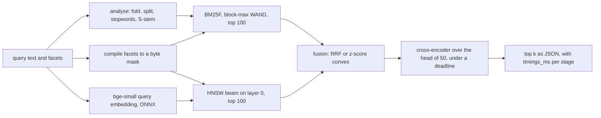
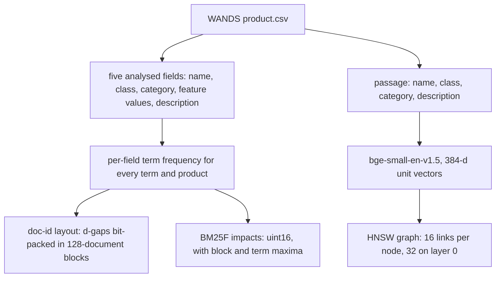

# hybrid-product-search

[](https://github.com/daniellopez882/hybrid-product-search/actions/workflows/ci.yml)  

A retrieve, fuse and rerank search engine for a furniture and home-goods catalogue, written
from the postings up. Lexical retrieval is field-weighted BM25F over a bit-packed inverted index,
pruned with block-max WAND; dense retrieval is an HNSW graph over bge-small-en-v1.5 vectors; both
are numba kernels written for this repository. The two candidate lists are fused by reciprocal
rank fusion or by a convex combination of z-scored scores whose weight is chosen by 5-fold cross
validation, and the head of the fused list is reranked by the ms-marco MiniLM cross-encoder under
a deadline. A Falcon ASGI service answers `/search` with the hits and the wall time of every
stage.

The evaluation set is Wayfair's WANDS: 42,994 products, 480 queries and 233,448 graded
judgements. bm25s and faiss-cpu are run next to the in-house kernels as reference points; they
are not used by the engine.

This document follows one query through the engine, gives each stage its knob and its measured
cost, and ends with the relevance and latency tables.

Every number below comes from one run of `prodsearch bench` over the full WANDS set, stored with
the machine description, package versions, git commit and command in
[`bench/results/wands.json`](bench/results/wands.json). Measured on: Intel Core i5-8500, 6 cores,
12 GB RAM, Windows 10, CPU only, Python 3.12, on 2026-10-14 at commit `c17ddca`. The machine was
not idle: other processes kept 2.6 of the 6 cores busy on average over the run (between 2.0 and
3.0 during the timed sections, recorded per section under `cpu_load`), so the latencies are those
of a loaded desktop.

What the run shows, in short:

- **Fusion is where the relevance comes from.** RRF of BM25F and HNSW reaches nDCG@10 0.775,
  against 0.738 for the better lexical retriever and 0.729 for HNSW alone; the paired difference
  over BM25F is +0.037 with a 95% interval of [0.023, 0.052].
- **CV-tuned convex fusion does not beat untuned RRF on nDCG@10** (+0.001, interval
  [-0.007, 0.010]); it is ahead on MRR@10 by 0.019, with an interval that includes zero.
- **The cross-encoder does not raise nDCG@10** on either fused list, and the shallowest rerank
  depth tried (10) scores highest. It does raise RRF's MRR@10 from 0.729 to 0.774, and it is
  639 ms of the cascade's 649 ms median.
- **Block-max WAND is exact but barely faster at k = 10 and slower at k = 100.** It returned the
  exhaustive top-k for every query and fully scored 578 products per query instead of 8,236 at
  k = 10, yet its median is 0.264 ms against 0.281 ms for exhaustive scoring and its p99 is worse
  (1.766 ms against 1.091 ms); at k = 100 exhaustive scoring wins outright (0.308 ms against
  0.555 ms). bm25s with its numba backend is faster than all of them.
- **The in-house HNSW is within reach of faiss.** At recall@10 0.95 both need ef 96, with medians
  of 0.247 ms and 0.176 ms; at the 0.99 target both need ef 768 and the in-house graph is faster
  (1.400 ms against 1.725 ms).

## Query lifecycle



The index the query runs against is built once, offline:



## Stage budgets

Each stage has one knob that trades cost for quality. The measured columns are wall times from
200 WANDS queries sent one at a time through the configuration a deployment would use: BM25F
weights and alpha tuned on all queries (name 4, class 2, category 0, features 0.5, description 1;
alpha 0.4), convex fusion, and the cross-encoder over the full head of 50 with no deadline. The
timed queries carry no facets, so the filter row is the cost of noticing that.

| Stage | In, out | Knob (default) | p50 | p95 |
|---|---|---|---|---|
| analyse | query text, terms | none | 0.014 ms | 0.019 ms |
| filter | facets, byte mask | only runs when facets are given | 0.002 ms | 0.002 ms |
| lexical | terms and mask, top 100 BM25F | depth 100, kernel `bmw` | 0.639 ms | 2.158 ms |
| embed | query text, 384-d vector | ONNX intra-op threads | 8.551 ms | 12.761 ms |
| ann | vector and mask, top 100 | `ef_search` 128; exact scan below 2,000 matches | 0.440 ms | 0.821 ms |
| fusion | two lists, one ranking | `rrf` or `convex` with alpha | 0.394 ms | 0.628 ms |
| rerank | fused head, reordered head | depth 50; service deadline 1000 ms | 639.1 ms | 829.2 ms |
| **total** | | | **649.1 ms** | **839.1 ms** |

The p99 of the total is 935.4 ms, under the service's 1000 ms rerank deadline even though the
benchmark set none. Without the rerank, the RRF cascade takes 9.845 ms at p50 and 15.256 ms at
p95 (95.98 queries per second, one at a time); the query embedding is most of that.

ONNX Runtime's worker threads spin between parallel sections by default. The engine turns that
off, and the benchmark runs the same 200 queries again with spinning on: the total median rises to
1299.3 ms with the rerank and to 36.797 ms without it, and the embed stage's p95 goes from
12.761 ms to 63.445 ms. Spinning threads hold cores that the numba kernels, the second ONNX session
and, on this machine, the other running processes all compete for.

### 1. Analyse

`analysis.py` folds accents ("Décor" meets "decor"), splits on anything that is not a letter or
digit, drops Lucene's 33 English stopwords and strips plurals with Harman's S-stemmer plus one
rule for sibilant stems ("benches" to "bench", "glasses" to "glass"). Porter stemming was not
used because it conflates catalogue words that shoppers keep apart ("organic" and "organizer"
both become "organ"). The same analyser runs at index and query time. Budget: 0.014 ms at p50;
analysing all five fields of the 42,994 products at index time takes 4.66 s.

### 2. Filter

Facets (`class`, `category` path prefix, `min_rating`, `min_reviews`, `attr=key=value`) compile to
one byte per product. The mask is passed *into* both retrievers rather than applied to the
result page, so a selective facet still returns a full page ([ADR 4](docs/adr/0004-filters-inside-retrieval.md)).
WANDS products can carry several classes (`Bookcases|Wall Mounted Shelves`); a class facet
matches any of them.

### 3. Lexical: BM25F with block-max WAND

Fields and their a-priori weights (chosen before any WANDS run): name 2, class 1, category 1,
feature values 0.5, description 1, with b of 0.5 on the three short fields, 0.75 on the long
ones and k1 of 1.2. The benchmark also tunes the weights over an 81-point grid by cross
validation.

- **Layout** ([ADR 2](docs/adr/0002-frame-of-reference-blocks.md)). Each term's postings are cut
  into 128-document blocks; a block stores `gap - 1` for each posting at one bit width, so runs
  of consecutive ids cost nothing. Per-block arrays keep the last doc id, the bit width and two
  offsets, which lets a cursor skip whole blocks without decoding them.
- **Doc order** ([ADR 5](docs/adr/0005-category-clustered-doc-ids.md)). Internal doc ids are
  assigned in (category path, class, name) order, so products that share vocabulary sit next to
  each other in every posting list; the index translates back to catalogue positions on the way
  out. The benchmark also builds the index in WANDS order to measure what this buys.
- **Impacts** ([ADR 1](docs/adr/0001-integer-impacts-for-exact-pruning.md)). The full BM25F term
  score is computed at index time and quantised to 16 bits, so a query score is an integer sum
  and every kernel produces bit-identical scores.
- **Kernels** (`lexical/wand.py`). Exhaustive term-at-a-time scoring, WAND, and block-max WAND:
  the pivot is found from term upper bounds, then the block maxima of the blocks that would hold
  the pivot are checked before any block is decoded; if they cannot beat the threshold, the
  strongest cursor jumps past the nearest block end. Ties go to the lower internal id, and the
  hypothesis tests require WAND and BMW to return exactly the exhaustive top-k, with and without
  filter masks, on random corpora with blocks as small as one posting.

Budget: 0.639 ms at p50 and 2.158 ms at p95 for the top 100 in the cascade. On WANDS the pruning
saves scoring work but not time at the cascade's depth of 100 (see the kernel table below): the
catalogue is small enough that scoring every posting of a query's terms already takes about
0.3 ms.

### 4. Dense: bge-small and HNSW

Products are embedded once as `name. class. category. description`, truncated to 128 tokens, CLS
pooled and L2 normalised. Queries get bge's retrieval instruction prefix.

`dense/hnsw.py` implements the HNSW paper's insertion: greedy descent through the upper layers,
an `ef_construction` beam per layer, neighbour selection with the diversity heuristic, and
bidirectional links shrunk with the same heuristic when a node overflows. Levels are drawn with
`mL = 1 / ln(M)`. A query descends greedily to layer 0 and runs one beam of width
`max(ef, k)`; with a facet mask, failing nodes are expanded but never returned. Below 2,000
matching products the engine skips the graph and scans the matching vectors exactly. Neighbour
rows are scattered in memory, so the beam computes the distances of an expanded node's unvisited
neighbours four rows at a time, which keeps more loads in flight than one dot product after
another.

Budget: the query embedding is the expensive half, 8.551 ms at p50 and 12.761 ms at p95; the
graph search for the top 100 at `ef_search` 128 takes 0.440 ms and 0.821 ms. At that setting the
graph finds 0.941 of the exact top 100 (faiss: 0.943).

### 5. Fuse

- **RRF**, k = 60, untuned: `sum 1 / (60 + rank)` over the two lists.
- **Convex**: both retrievers score the *union* of the two candidate lists (the lexical index
  scores dense-only hits exactly with a seek per term), each score vector is z-normalised over
  the union, and `alpha * z_lex + (1 - alpha) * z_dense` ranks it. Alpha comes from a 21-point
  grid, chosen per fold ([ADR 3](docs/adr/0003-cross-validated-fusion.md)); the five folds chose
  0.4, 0.45, 0.45, 0.4 and 0.45.

Budget: convex fusion takes 0.394 ms at p50, most of it rescoring the union exactly; RRF takes
0.117 ms.

### 6. Rerank under a deadline

`rerank.py` scores the fused head with the cross-encoder in batches of 10, in fused order, and
checks the clock between batches. If the deadline passes, the scored prefix is reordered by
cross-encoder logit and everything else keeps its fused order behind it, so a slow query
degrades towards the fusion ranking instead of missing its budget. The response says how many
products were reranked and whether the deadline cut the rerank short. The benchmark reranks the
full head of 50 with no deadline.

Budget: 639.1 ms at p50 and 829.2 ms at p95 for 50 pairs, nearly all of the cascade's 649.1 ms
median. Over the relevance run the int8 cross-encoder scored 28,224 distinct pairs in 460.7 s,
61.3 pairs per second. The depth sweep below shows nDCG@10 no lower with a head of 10; the latency
of a 10-product rerank was not measured, so the default stays at 50.

## Relevance on WANDS

All 480 queries, each scored by settings chosen on the other four folds. nDCG@10 uses the WANDS
grades as linear gains (Exact 2, Partial 1, Irrelevant 0); Recall@100 and MRR@10 count only Exact
products as relevant and skip queries without one. Intervals are 95% percentile bootstrap
intervals over queries.

One query has no positive grade and is left out of nDCG (479 scored); 379 queries have at least
one Exact product and are scored for Recall@100 and MRR@10.

| Method | nDCG@10 | Recall@100 | MRR@10 |
|---|---|---|---|
| BM25, one concatenated field (in-house, BMW) | 0.709 [0.681, 0.736] | 0.660 [0.625, 0.695] | 0.721 [0.680, 0.761] |
| bm25s, same tokens, Lucene variant | 0.709 [0.681, 0.736] | 0.660 [0.625, 0.695] | 0.721 [0.680, 0.761] |
| BM25F, a-priori weights | 0.730 [0.704, 0.757] | 0.689 [0.654, 0.723] | 0.735 [0.696, 0.774] |
| BM25F, weights by 5-fold CV | 0.738 [0.711, 0.764] | 0.679 [0.644, 0.713] | 0.738 [0.699, 0.778] |
| bge-small, exact | 0.737 [0.712, 0.763] | 0.634 [0.600, 0.668] | 0.715 [0.674, 0.755] |
| bge-small, in-house HNSW | 0.729 [0.703, 0.755] | 0.617 [0.581, 0.653] | 0.699 [0.658, 0.741] |
| RRF (BM25F CV + HNSW) | 0.775 [0.751, 0.798] | 0.690 [0.657, 0.723] | 0.729 [0.691, 0.768] |
| Convex, alpha by 5-fold CV | **0.776** [0.753, 0.799] | **0.695** [0.661, 0.727] | 0.748 [0.710, 0.787] |
| RRF + cross-encoder | 0.775 [0.751, 0.798] | 0.690 [0.657, 0.723] | **0.774** [0.737, 0.811] |
| Convex + cross-encoder | 0.774 [0.750, 0.798] | 0.695 [0.661, 0.727] | 0.766 [0.729, 0.803] |
| Lucene or Elasticsearch BM25 | not run | not run | not run |

The in-house single-field BM25 and bm25s agree on 0.996 of the top 10 and 0.999 of the top 100
products per query, and all three metrics agree to the third decimal.

The CV folds chose BM25F weights of name 4 and description 1 in every fold, class 2 in four of
five, category 0 in four of five, and features 0.5 in four of five.

**Paired differences**, a minus b over the same queries, with 95% bootstrap intervals:

| a minus b | nDCG@10 | Recall@100 | MRR@10 |
|---|---|---|---|
| BM25F CV minus BM25 | +0.029 [0.017, 0.041] | +0.019 [0.001, 0.036] | +0.018 [-0.007, 0.043] |
| BM25F CV minus BM25F a-priori | +0.007 [-0.000, 0.015] | -0.010 [-0.023, 0.002] | +0.003 [-0.013, 0.020] |
| HNSW minus exact dense | -0.008 [-0.015, -0.002] | -0.017 [-0.031, -0.006] | -0.015 [-0.029, -0.004] |
| RRF minus BM25F CV | +0.037 [0.023, 0.052] | +0.011 [-0.001, 0.024] | -0.009 [-0.037, 0.018] |
| RRF minus HNSW | +0.046 [0.032, 0.059] | +0.073 [0.054, 0.093] | +0.030 [0.004, 0.056] |
| Convex CV minus RRF | +0.001 [-0.007, 0.010] | +0.005 [-0.005, 0.014] | +0.019 [-0.002, 0.040] |
| RRF + rerank minus RRF | -0.000 [-0.011, 0.011] | 0 (head reordered only) | +0.045 [0.017, 0.073] |
| Convex + rerank minus convex | -0.002 [-0.014, 0.009] | 0 (head reordered only) | +0.018 [-0.007, 0.043] |
| Convex + rerank minus RRF + rerank | -0.001 [-0.005, 0.003] | +0.005 [-0.005, 0.014] | -0.008 [-0.016, -0.002] |

The HNSW graph costs a small but measurable amount of relevance against exact dense search, all
three intervals below zero. Tuning BM25F's weights on held-out folds gains 0.007 nDCG@10 over the
a-priori weights, with an interval that reaches zero, and gives up 0.010 of Recall@100.

**Rerank depth**, convex CV list, cross-encoder over the top n only:

| Head reranked | nDCG@10 |
|---|---|
| none (convex CV) | 0.776 [0.753, 0.799] |
| 10 | 0.780 [0.757, 0.803] |
| 20 | 0.779 [0.755, 0.803] |
| 30 | 0.775 [0.752, 0.799] |
| 50 | 0.774 [0.750, 0.798] |

## Latency and cost

Measured on: Intel Core i5-8500, 6 cores, 12 GB RAM, Windows 10, CPU only, 2026-10-14. One
query at a time, one thread per kernel; other processes kept 3.0 cores busy on average while the
lexical kernels were timed and 2.57 while the graphs were.

**Lexical kernels**, all 480 queries, each timed three times and its median kept; p50 and p99 are
over queries, in milliseconds. "Docs scored" counts products whose full score was computed;
"blocks" counts 128-posting blocks decoded.

| Index / kernel | k | p50 | p99 | docs scored | blocks | same top-k as exhaustive |
|---|---|---|---|---|---|---|
| BM25 exhaustive | 10 | 0.297 | 1.228 | 8,236 | 80.3 | reference |
| BM25 WAND | 10 | 0.309 | 2.325 | 839 | 53.8 | 480 of 480 |
| BM25 BMW | 10 | 0.256 | 1.682 | 539 | 48.7 | 480 of 480 |
| BM25F exhaustive, category doc order | 10 | 0.281 | 1.091 | 8,236 | 80.3 | reference |
| BM25F WAND, category doc order | 10 | 0.318 | 2.270 | 892 | 54.0 | 480 of 480 |
| BM25F BMW, category doc order | 10 | 0.264 | 1.766 | 578 | 49.1 | 480 of 480 |
| BM25F exhaustive, WANDS doc order | 10 | 0.296 | 1.098 | 8,236 | 80.3 | reference |
| BM25F WAND, WANDS doc order | 10 | 0.393 | 3.355 | 680 | 69.9 | 480 of 480 |
| BM25F BMW, WANDS doc order | 10 | 0.345 | 2.492 | 522 | 68.8 | 480 of 480 |
| bm25s, numpy backend | 10 | 1.178 | 2.875 | not reported | not reported | n/a |
| bm25s, numba backend | 10 | 0.088 | 0.255 | not reported | not reported | n/a |
| BM25F exhaustive, category doc order | 100 | 0.308 | 1.156 | 8,236 | 80.3 | reference |
| BM25F WAND, category doc order | 100 | 0.675 | 3.771 | 2,312 | 66.9 | 480 of 480 |
| BM25F BMW, category doc order | 100 | 0.555 | 2.831 | 1,710 | 63.8 | 480 of 480 |
| BM25F BMW, WANDS doc order | 100 | 0.667 | 3.148 | 1,728 | 77.7 | 480 of 480 |
| bm25s, numba backend | 100 | 0.119 | 0.375 | not reported | not reported | n/a |
| Lucene | 10, 100 | not run | not run | not run | not run | not run |

Three things in this table go against the design's expectations, and they are reported as they
came out. Pruning cuts fully scored products by an order of magnitude but leaves the k = 10 median
almost where exhaustive scoring has it and makes the tail worse. At k = 100 BMW still fully scores
1,710 products per query, and exhaustive scoring is the fastest in-house kernel. bm25s, which
stores every posting's precomputed score in a sparse matrix and sums the query's columns, beats
every in-house kernel with its numba backend. What the category doc order does deliver is the
locality ADR 5 aimed for: BMW decodes 49.1 blocks per query instead of 68.8 and its k = 10 median
drops from 0.345 ms to 0.264 ms.

**HNSW against faiss at matched recall**, both single-threaded with M 16, efConstruction 200 and
inner product; recall@10 against exact search over all 480 query vectors, at the smallest ef in
the sweep (10 to 1024) that reaches the target:

| Target recall@10 | In-house: ef, recall, p50, p99 | faiss: ef, recall, p50, p99 |
|---|---|---|
| 0.9 | 32, 0.9158, 0.127 ms, 0.397 ms | 32, 0.9056, 0.082 ms, 0.356 ms |
| 0.95 | 96, 0.9598, 0.247 ms, 0.543 ms | 96, 0.9621, 0.176 ms, 0.594 ms |
| 0.99 | 768, 0.9915, 1.400 ms, 2.577 ms | 768, 0.9933, 1.725 ms, 2.502 ms |

At the service's `ef_search` of 128 the in-house graph reaches recall@10 0.9679 in 0.307 ms at p50,
and faiss 0.9700 in 0.215 ms. faiss is faster up to ef 384 and the in-house beam from ef 512 up;
the full sweep is in the results file.

**Index build**, single-threaded:

| Step | Time | Size |
|---|---|---|
| Analyse five fields of 42,994 products | 4.66 s | |
| Category doc order | 0.21 s | |
| Per-field term frequencies | 3.99 s | |
| Doc-id layout, 128-document blocks | 1.55 s | 3,351,412 B of doc ids, 7.50 bits per posting (8.12 in WANDS order; 14,300,312 B as 32-bit ids) and 1,963,712 B of block metadata |
| BM25F impacts | 0.47 s | 7,150,156 B of impacts and 498,088 B of block maxima |
| BM25F index, total | | 12,963,368 B (13,241,960 B in WANDS order) for 3,575,078 postings of 50,098 terms |
| BM25F weight grid: 81 impact rebuilds and 480 queries each | 63.9 s | |
| bm25s index, same tokens | 4.47 s | 29,001,416 B |
| Product embeddings, bge-small ONNX | 2021.5 s, 21.3 products per second | 66,038,784 B |
| In-house HNSW | 31.3 s | 6,389,220 B of links, plus the vectors |
| faiss HNSW | 16.4 s | 72,242,002 B serialised, vectors included |

The embedding time is the one recorded when the vectors were computed and cached, earlier on the
same day; the run that produced every other number read them from the cache.

**Filtered search**, with each query's own WANDS class as the facet (469 queries have a class
that matches products; the median query matches 315 products):

| Measure | Value |
|---|---|
| BMW, filtered top 100: p50, p99 | 0.996 ms, 6.04 ms |
| Exhaustive, filtered top 100: p50, p99 | 0.277 ms, 0.580 ms |
| BMW identical to exhaustive filtered search | 469 of 469 queries |
| HNSW with the mask inside the beam, top 10 at ef 128: recall@10, p50, p95 | 0.9968, 0.817 ms, 26.5 ms |
| RRF nDCG@10 with a-priori BM25F, unfiltered | 0.774 [0.749, 0.798] |
| The same with the class facet | 0.767 [0.742, 0.792] |

With a facet, BMW is slower than exhaustive scoring at every percentile shown. Every one of the
469 facets matches fewer than 2,000 products, so the engine would scan the matching vectors
exactly instead of entering the graph. The HNSW row measures the in-beam filter on its own: its
p95 of 26.5 ms, against 0.489 ms for an unfiltered top 10 at the same ef, is the cost that
fallback avoids.

## Quick start

Requires [uv](https://docs.astral.sh/uv/). The sample catalogue ships with the package, so the
sample commands need no dataset or model download:

```bash
git clone https://github.com/daniellopez882/hybrid-product-search
cd hybrid-product-search
uv sync
uv run prodsearch search "bar stools" --sample
uv run prodsearch serve --sample          # http://127.0.0.1:8000/search?q=fire%20pit
```

The full catalogue, about 96 MB of WANDS files and 158 MB of ONNX models, each verified against
the sha256 committed in `src/prodsearch/sources.py`:

```bash
export PRODSEARCH_DATA_DIR=~/.cache/hybrid-product-search   # the default
uv run prodsearch fetch
uv run prodsearch index                  # postings, product vectors, HNSW graph
uv run prodsearch search "chair and a half recliner" --class Recliners
uv run prodsearch serve --host 0.0.0.0
```

Models are stored in the Hugging Face cache layout under `HF_HOME`, so copies fetched by other
tools are verified and reused. With Docker, the default command serves the sample catalogue:

```bash
docker build -t prodsearch .
docker run --rm -p 8000:8000 prodsearch
```

## HTTP API

`GET /search` (or `POST /search` with the same fields as JSON):

| Parameter | Meaning |
|---|---|
| `q` | query text (required) |
| `k` | results, 1 to 100 (default 10) |
| `mode` | `hybrid`, `lexical` or `dense` |
| `fusion`, `alpha` | `rrf` (default) or `convex` with the lexical weight in [0, 1] |
| `rerank` | `true` or `false` |
| `class`, `category`, `min_rating`, `min_reviews`, `attr` | facets; `class` and `attr` repeat |

The response carries `hits` (product id, name, class, fused score, lexical and dense ranks,
cross-encoder logit), the applied `filters`, `stages`, `timings_ms` per stage, `reranked`,
`rerank_truncated`, `filter_matches` and the lexical kernel's counters. `GET /healthz` reports the catalogue size and
which stages are loaded.

## Running the benchmark

The numbers in this document are reproduced with:

```bash
export PRODSEARCH_DATA_DIR=~/.cache/hybrid-product-search   # WANDS files and the vector cache
uv run prodsearch fetch
uv run prodsearch bench --out bench/results/wands.json
```

One command runs every table above and writes one JSON file with the machine (CPU, cores, RAM,
OS, Python and package versions), the local date, the git commit, the exact command and the CPU
time other processes used during each timed section. The product vectors are cached under
`PRODSEARCH_DATA_DIR/cache`, keyed by model, maximum length and the passage texts, together with
the time the embedding took. On the machine above the published run took 1,110 s with the
vectors cached; the first run also embeds the catalogue (2021.5 s there). `--smoke` runs the same
code on 5 queries and their judged products (at most 120 per query).

The default test suite needs no data and no network: `uv run pytest`. Tests that read the real
WANDS files and models are marked `integration` and run with `uv run pytest -m integration`.

## Data and model licences

| Artefact | Source | Licence | In this repository |
|---|---|---|---|
| WANDS products, queries, labels | [wayfair/WANDS](https://github.com/wayfair/WANDS) at a pinned commit | MIT | No, fetched by `prodsearch fetch` |
| bge-small-en-v1.5 (ONNX export) | [BAAI/bge-small-en-v1.5](https://huggingface.co/BAAI/bge-small-en-v1.5) at a pinned revision | MIT | No, fetched |
| ms-marco-MiniLM-L6-v2 (int8 ONNX) | [cross-encoder/ms-marco-MiniLM-L6-v2](https://huggingface.co/cross-encoder/ms-marco-MiniLM-L6-v2) at a pinned revision | Apache-2.0 | No, fetched |
| Sample catalogue | written for this repository in the WANDS column layout | MIT, as the code | Yes, `src/prodsearch/sample/` |

WANDS repeats some (query, product) rows: the 233,448 label rows hold 231,873 distinct pairs, 14
of them with conflicting grades. A repeated pair keeps its highest grade.

## Limitations

- **Judgement pool.** WANDS judges a pooled set of products per query, and unjudged products count
  as irrelevant. A system that surfaces relevant products the pool missed is penalised, which
  biases the comparison towards systems that resemble the pooling ones.
- **480 queries.** The bootstrap intervals are wide enough that convex fusion and RRF cannot be
  told apart on nDCG@10, and neither can reranked and unreranked lists; only the paired
  differences with intervals clear of zero support a claim.
- **A loaded machine.** Other processes kept between 2.0 and 3.0 of the 6 cores busy while the
  latency sections ran. The numbers are what this desktop delivered then, not an idle-machine
  figure, and the spinning ablation in particular depends on how contended the cores are.
- **CPU only, one query at a time.** Latency is measured sequentially on one machine; there is no
  concurrency or throughput-under-load benchmark. The cross-encoder dominates the cascade's cost
  on this CPU.
- **Pruning does not pay on this catalogue.** With 42,994 products, exhaustive scoring is as fast
  as block-max WAND at k = 10 and faster at k = 100 or with a facet. The pruned kernels are exact,
  so the engine is correct with either; the default `bmw` was chosen before the measurement, and
  `SearchRequest.lexical_method` selects `exhaustive` (the HTTP API does not expose it).
- **Rerank without a deadline.** Relevance with the cross-encoder is measured with no deadline;
  under the service's 1000 ms deadline a slower query would rerank only part of its head.
- **Embedding time** comes from the run that filled the vector cache, earlier the same day, not
  from the run that produced the other numbers.
- **Truncation.** Both models read at most 128 tokens, so long descriptions are cut.
- **Text analysis.** Plural stripping only: no synonyms, spelling correction or unit handling
  ("8x10" and "8 x 10" tokenise differently).
- **Index-time weights.** Field weights are baked into the impacts; changing them means
  recomputing impacts (the doc-id layout is reused).
- **HNSW build** is single-threaded and inserts in catalogue order; no deletes or updates.
- **Baselines.** bm25s is compared on the same tokens, so the comparison isolates the scoring and
  retrieval code, not tokenisation. Lucene and Elasticsearch were not run.
- **Filtered benchmark.** Using each query's WANDS class as its facet is an oracle choice of
  facet; it measures the mechanics of filtered retrieval, not how shoppers pick facets.

## Repository layout

```
src/prodsearch/
  analysis.py        folding, tokenising, S-stemmer
  catalog.py         WANDS loaders, feature parsing, smoke subsets
  lexical/           layout.py (bit-packed blocks), wand.py (kernels), bm25f.py (impacts, doc order)
  dense/             hnsw.py (graph build and search), encoders.py (ONNX models)
  filters.py         facet masks
  fusion.py          RRF and z-score convex fusion
  rerank.py          deadline-bounded cross-encoder cascade
  engine.py          the timed query lifecycle
  service.py         Falcon ASGI app
  store.py           index build and load
  sources.py         pinned downloads and sha256 checks
  bench/             benchmark harness, metrics, cross validation, baselines
tests/               unit, property and contract tests; integration tests marked
docs/adr/            design decisions
bench/results/       benchmark output (JSON)
```

## Design decisions

1. [Quantise BM25F term scores to 16-bit integers](docs/adr/0001-integer-impacts-for-exact-pruning.md)
2. [Bit-pack d-gaps per 128-document block](docs/adr/0002-frame-of-reference-blocks.md)
3. [Tune fusion and field weights on held-out folds](docs/adr/0003-cross-validated-fusion.md)
4. [Apply filters inside both retrievers](docs/adr/0004-filters-inside-retrieval.md)
5. [Assign internal doc ids in category order](docs/adr/0005-category-clustered-doc-ids.md)

## Licence

MIT, see [LICENSE](LICENSE).
