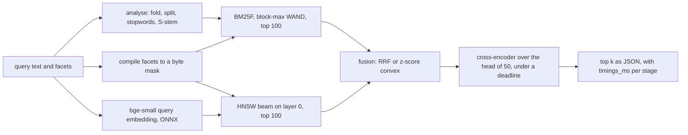
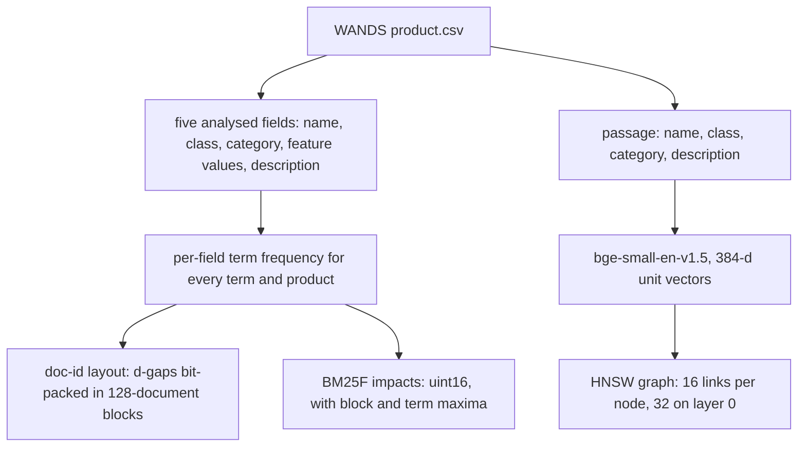

# hybrid-product-search

A retrieve, fuse and rerank search engine for a furniture and home-goods catalogue, written
from the postings up. Lexical retrieval is field-weighted BM25F over a bit-packed inverted index,
pruned with block-max WAND; dense retrieval is an HNSW graph over bge-small-en-v1.5 vectors; both
are numba kernels written for this repository. The two candidate lists are fused by reciprocal
rank fusion or by a convex combination of z-scored scores whose weight is chosen by 5-fold cross
validation, and the head of the fused list is reranked by the ms-marco MiniLM cross-encoder under
a deadline. A Falcon ASGI service answers `/search` with the hits and the wall time of every
stage.

The evaluation set is Wayfair's WANDS: 42,994 products, 480 queries and 233,448 graded
judgements. bm25s and faiss-cpu are run next to the in-house kernels as reference points; they
are not used by the engine.

This document follows one query through the engine, gives each stage its knob and its measured
cost, and ends with the relevance and latency tables.

> **Status:** the harness has run end to end on a 5-query smoke subset. Every table below is
> **pending benchmark**: the full WANDS run has not been executed yet, and no number is filled
> in until it has.

## Query lifecycle



The index the query runs against is built once, offline:



## Stage budgets

Each stage has one knob that trades cost for quality. The measured columns come from the cascade
benchmark (sequential queries, one at a time) and are filled in after the full run.

| Stage | In, out | Knob (default) | p50 | p95 |
|---|---|---|---|---|
| analyse | query text, terms | none | pending benchmark | pending benchmark |
| filter | facets, byte mask | only runs when facets are given | pending benchmark | pending benchmark |
| lexical | terms and mask, top 100 BM25F | depth 100, kernel `bmw` | pending benchmark | pending benchmark |
| embed | query text, 384-d vector | ONNX intra-op threads | pending benchmark | pending benchmark |
| ann | vector and mask, top 100 | `ef_search` 128; exact scan below 2,000 matches | pending benchmark | pending benchmark |
| fusion | two lists, one ranking | `rrf` or `convex` with alpha | pending benchmark | pending benchmark |
| rerank | fused head, reordered head | depth 50; service deadline 1000 ms | pending benchmark | pending benchmark |

### 1. Analyse

`analysis.py` folds accents ("Décor" meets "decor"), splits on anything that is not a letter or
digit, drops Lucene's 33 English stopwords and strips plurals with Harman's S-stemmer plus one
rule for sibilant stems ("benches" to "bench", "glasses" to "glass"). Porter stemming was not
used because it conflates catalogue words that shoppers keep apart ("organic" and "organizer"
both become "organ"). The same analyser runs at index and query time.

### 2. Filter

Facets (`class`, `category` path prefix, `min_rating`, `min_reviews`, `attr=key=value`) compile to
one byte per product. The mask is passed *into* both retrievers rather than applied to the
result page, so a selective facet still returns a full page ([ADR 4](docs/adr/0004-filters-inside-retrieval.md)).
WANDS products can carry several classes (`Bookcases|Wall Mounted Shelves`); a class facet
matches any of them.

### 3. Lexical: BM25F with block-max WAND

Fields and their a-priori weights (chosen before any WANDS run): name 2, class 1, category 1,
feature values 0.5, description 1, with b of 0.5 on the three short fields, 0.75 on the long
ones and k1 of 1.2. The benchmark also tunes the weights over an 81-point grid by cross
validation.

- **Layout** ([ADR 2](docs/adr/0002-frame-of-reference-blocks.md)). Each term's postings are cut
  into 128-document blocks; a block stores `gap - 1` for each posting at one bit width, so runs
  of consecutive ids cost nothing. Per-block arrays keep the last doc id, the bit width and two
  offsets, which lets a cursor skip whole blocks without decoding them.
- **Impacts** ([ADR 1](docs/adr/0001-integer-impacts-for-exact-pruning.md)). The full BM25F term
  score is computed at index time and quantised to 16 bits, so a query score is an integer sum
  and every kernel produces bit-identical scores.
- **Kernels** (`lexical/wand.py`). Exhaustive term-at-a-time scoring, WAND, and block-max WAND:
  the pivot is found from term upper bounds, then the block maxima of the blocks that would hold
  the pivot are checked before any block is decoded; if they cannot beat the threshold, the
  strongest cursor jumps past the nearest block end. Ties go to the lower doc id, and the
  hypothesis tests require WAND and BMW to return exactly the exhaustive top-k, with and without
  filter masks, on random corpora with blocks as small as one posting.

### 4. Dense: bge-small and HNSW

Products are embedded once as `name. class. category. description`, truncated to 128 tokens, CLS
pooled and L2 normalised. Queries get bge's retrieval instruction prefix.

`dense/hnsw.py` implements the HNSW paper's insertion: greedy descent through the upper layers,
an `ef_construction` beam per layer, neighbour selection with the diversity heuristic, and
bidirectional links shrunk with the same heuristic when a node overflows. Levels are drawn with
`mL = 1 / ln(M)`. A query descends greedily to layer 0 and runs one beam of width
`max(ef, k)`; with a facet mask, failing nodes are expanded but never returned. Below 2,000
matching products the engine skips the graph and scans the matching vectors exactly.

### 5. Fuse

- **RRF**, k = 60, untuned: `sum 1 / (60 + rank)` over the two lists.
- **Convex**: both retrievers score the *union* of the two candidate lists (the lexical index
  scores dense-only hits exactly with a seek per term), each score vector is z-normalised over
  the union, and `alpha * z_lex + (1 - alpha) * z_dense` ranks it. Alpha comes from a 21-point
  grid, chosen per fold ([ADR 3](docs/adr/0003-cross-validated-fusion.md)).

### 6. Rerank under a deadline

`rerank.py` scores the fused head with the cross-encoder in batches of 10, in fused order, and
checks the clock between batches. If the deadline passes, the scored prefix is reordered by
cross-encoder logit and everything else keeps its fused order behind it, so a slow query
degrades towards the fusion ranking instead of missing its budget. The response says how many
products were reranked and whether the deadline cut the rerank short. The benchmark reranks the
full head of 50 with no deadline.

## Relevance on WANDS

All 480 queries, each scored by settings chosen on the other four folds. nDCG@10 uses the WANDS
grades as linear gains (Exact 2, Partial 1, Irrelevant 0); Recall@100 and MRR@10 count only Exact
products as relevant and skip queries without one. Intervals are 95% percentile bootstrap
intervals over queries.

| Method | nDCG@10 | Recall@100 | MRR@10 |
|---|---|---|---|
| BM25, one concatenated field (in-house, BMW) | pending benchmark | pending benchmark | pending benchmark |
| bm25s, same tokens, Lucene variant | pending benchmark | pending benchmark | pending benchmark |
| BM25F, a-priori weights | pending benchmark | pending benchmark | pending benchmark |
| BM25F, weights by 5-fold CV | pending benchmark | pending benchmark | pending benchmark |
| bge-small, exact | pending benchmark | pending benchmark | pending benchmark |
| bge-small, in-house HNSW | pending benchmark | pending benchmark | pending benchmark |
| RRF (BM25F CV + HNSW) | pending benchmark | pending benchmark | pending benchmark |
| Convex, alpha by 5-fold CV | pending benchmark | pending benchmark | pending benchmark |
| RRF + cross-encoder | pending benchmark | pending benchmark | pending benchmark |
| Convex + cross-encoder | pending benchmark | pending benchmark | pending benchmark |

Paired differences (bootstrap over the same queries) for the comparisons the design depends on,
and the rerank-depth sweep, are written to the results file: pending benchmark.

## Latency and cost

Measured on: Intel Core i5-8500, 6 cores, 12 GB RAM, Windows 10, CPU only; date pending
benchmark.

**Lexical kernels**, top 10 and top 100, the same 480 queries, median of three runs per query:

| Index / kernel | k | p50 | p99 | docs fully scored | identical to exhaustive |
|---|---|---|---|---|---|
| BM25 exhaustive | 10 | pending benchmark | pending benchmark | pending benchmark | reference |
| BM25 WAND | 10 | pending benchmark | pending benchmark | pending benchmark | pending benchmark |
| BM25 BMW | 10 | pending benchmark | pending benchmark | pending benchmark | pending benchmark |
| bm25s (numpy, numba backends) | 10 | pending benchmark | pending benchmark | not reported | n/a |
| BM25F BMW | 100 | pending benchmark | pending benchmark | pending benchmark | pending benchmark |

**HNSW against faiss at matched recall** (both single-threaded, M 16, efConstruction 200, inner
product; recall@10 against exact search):

| Target recall@10 | In-house: ef, p50 | faiss: ef, p50 |
|---|---|---|
| 0.9 | pending benchmark | pending benchmark |
| 0.95 | pending benchmark | pending benchmark |
| 0.99 | pending benchmark | pending benchmark |

**Index build** (time and bytes): postings layout, impacts, bm25s index, embedding throughput,
in-house HNSW and faiss HNSW build: pending benchmark.

**Filtered search**, with each query's own WANDS class as the facet: BMW agreement with
exhaustive filtered search, filtered HNSW recall@10 and latency: pending benchmark.

## Quick start

Requires [uv](https://docs.astral.sh/uv/). The sample catalogue ships with the package, so the
sample commands need no dataset or model download:

```bash
git clone https://github.com/daniellopez882/hybrid-product-search
cd hybrid-product-search
uv sync
uv run prodsearch search "bar stools" --sample
uv run prodsearch serve --sample          # http://127.0.0.1:8000/search?q=fire%20pit
```

The full catalogue, about 96 MB of WANDS files and 158 MB of ONNX models, each verified against
the sha256 committed in `src/prodsearch/sources.py`:

```bash
export PRODSEARCH_DATA_DIR=~/.cache/hybrid-product-search   # the default
uv run prodsearch fetch
uv run prodsearch index                  # postings, product vectors, HNSW graph
uv run prodsearch search "chair and a half recliner" --class Recliners
uv run prodsearch serve --host 0.0.0.0
```

Models are stored in the Hugging Face cache layout under `HF_HOME`, so copies fetched by other
tools are verified and reused. With Docker, the default command serves the sample catalogue:

```bash
docker build -t prodsearch .
docker run --rm -p 8000:8000 prodsearch
```

## HTTP API

`GET /search` (or `POST /search` with the same fields as JSON):

| Parameter | Meaning |
|---|---|
| `q` | query text (required) |
| `k` | results, 1 to 100 (default 10) |
| `mode` | `hybrid`, `lexical` or `dense` |
| `fusion`, `alpha` | `rrf` (default) or `convex` with the lexical weight in [0, 1] |
| `rerank` | `true` or `false` |
| `class`, `category`, `min_rating`, `min_reviews`, `attr` | facets; `class` and `attr` repeat |

The response carries `hits` (product id, name, class, fused score, lexical and dense ranks,
cross-encoder logit), the applied `filters`, `stages`, `timings_ms` per stage, `reranked`,
`rerank_truncated`, `filter_matches` and the lexical kernel's counters. `GET /healthz` reports the catalogue size and
which stages are loaded.

## Running the benchmark

```bash
uv run prodsearch fetch
uv run prodsearch bench --out bench/results/wands.json
```

One command runs every table above and writes one JSON file with the machine (CPU, cores, RAM,
OS, Python and package versions), the local date, the git commit and the exact command. The
product vectors are cached under `PRODSEARCH_DATA_DIR/cache`, keyed by model, maximum length and
the passage texts, together with the time the embedding took. `--smoke` runs the same code on 5
queries and their judged products (at most 120 per query) in about two minutes.

The default test suite needs no data and no network: `uv run pytest`. Tests that read the real
WANDS files and models are marked `integration` and run with `uv run pytest -m integration`.

## Data and model licences

| Artefact | Source | Licence | In this repository |
|---|---|---|---|
| WANDS products, queries, labels | [wayfair/WANDS](https://github.com/wayfair/WANDS) at a pinned commit | MIT | No, fetched by `prodsearch fetch` |
| bge-small-en-v1.5 (ONNX export) | [BAAI/bge-small-en-v1.5](https://huggingface.co/BAAI/bge-small-en-v1.5) at a pinned revision | MIT | No, fetched |
| ms-marco-MiniLM-L6-v2 (int8 ONNX) | [cross-encoder/ms-marco-MiniLM-L6-v2](https://huggingface.co/cross-encoder/ms-marco-MiniLM-L6-v2) at a pinned revision | Apache-2.0 | No, fetched |
| Sample catalogue | written for this repository in the WANDS column layout | MIT, as the code | Yes, `src/prodsearch/sample/` |

WANDS repeats some (query, product) rows; a repeated pair keeps its highest grade, and the
number of conflicting pairs is recorded in the results file.

## Limitations

- **Judgement pool.** WANDS judges a pooled set of products per query, and unjudged products count
  as irrelevant. A system that surfaces relevant products the pool missed is penalised, which
  biases the comparison towards systems that resemble the pooling ones.
- **480 queries.** The bootstrap intervals are wide enough that small differences between fusion
  methods may not be distinguishable; the paired differences in the results file say which are.
- **CPU only, one query at a time.** Latency is measured sequentially on one machine; there is no
  concurrency or throughput-under-load benchmark. The cross-encoder dominates the cascade's cost
  on this CPU.
- **Truncation.** Both models read at most 128 tokens, so long descriptions are cut.
- **Text analysis.** Plural stripping only: no synonyms, spelling correction or unit handling
  ("8x10" and "8 x 10" tokenise differently).
- **Index-time weights.** Field weights are baked into the impacts; changing them means
  recomputing impacts (the doc-id layout is reused).
- **HNSW build** is single-threaded and inserts in catalogue order; no deletes or updates.
- **Baselines.** bm25s is compared on the same tokens, so the comparison isolates the scoring and
  retrieval code, not tokenisation. Lucene and Elasticsearch were not run.
- **Filtered benchmark.** Using each query's WANDS class as its facet is an oracle choice of
  facet; it measures the mechanics of filtered retrieval, not how shoppers pick facets.

## Repository layout

```
src/prodsearch/
  analysis.py        folding, tokenising, S-stemmer
  catalog.py         WANDS loaders, feature parsing, smoke subsets
  lexical/           layout.py (bit-packed blocks), wand.py (kernels), bm25f.py (impacts, index)
  dense/             hnsw.py (graph build and search), encoders.py (ONNX models)
  filters.py         facet masks
  fusion.py          RRF and z-score convex fusion
  rerank.py          deadline-bounded cross-encoder cascade
  engine.py          the timed query lifecycle
  service.py         Falcon ASGI app
  store.py           index build and load
  sources.py         pinned downloads and sha256 checks
  bench/             benchmark harness, metrics, cross validation, baselines
tests/               unit, property and contract tests; integration tests marked
docs/adr/            design decisions
bench/results/       benchmark output (JSON)
```

## Design decisions

1. [Quantise BM25F term scores to 16-bit integers](docs/adr/0001-integer-impacts-for-exact-pruning.md)
2. [Bit-pack d-gaps per 128-document block](docs/adr/0002-frame-of-reference-blocks.md)
3. [Tune fusion and field weights on held-out folds](docs/adr/0003-cross-validated-fusion.md)
4. [Apply filters inside both retrievers](docs/adr/0004-filters-inside-retrieval.md)

## Licence

MIT, see [LICENSE](LICENSE).
